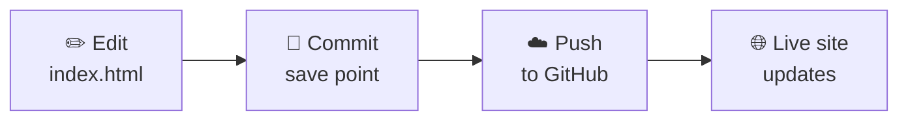
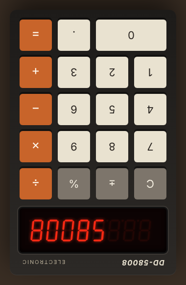
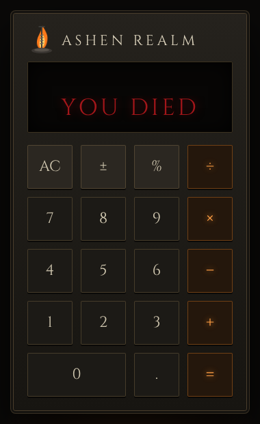
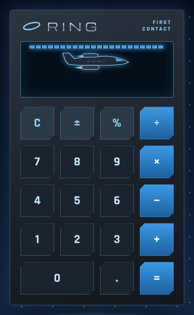

# Git lessons 🎮

Learn Git in 5 minutes, using this calculator as the example.

[← Back to the calculator](README.md)

---

## 💡 The big idea

Git is **save points for your code**, like in a video game.

- You play a bit (edit the code).
- You save (make a **commit**).
- If something breaks, you can load an old save.

GitHub is the **cloud** where your save points live, so anyone can see them.

---

## 📖 Three words to know

| Word | What it means | Game version |
| --- | --- | --- |
| **Commit** | Save a snapshot of your files, with a short note | Save your game |
| **Push** | Send your saves up to GitHub | Upload to the cloud |
| **Pull** | Get the newest saves from GitHub | Download from the cloud |

---

## 🔄 How this website updates



1. ✏️ Change `index.html` (for example, add a new skin).
2. 💾 **Commit** it with a note like `Add Purple Taco skin`.
3. ☁️ **Push** it to GitHub.
4. 🌐 About a minute later, the [live calculator](https://donaldweatherly645-coder.github.io/calculator-generic/) shows the change.

That's it. Every push updates the website by itself.

---

## ⌨️ The commands

Type these in the Terminal, inside the calculator folder.

```bash
git status
```
👉 What have I changed?

```bash
git add index.html
```
👉 Pick the file to save.

```bash
git commit -m "Add Purple Taco skin"
```
👉 Save it, with a note.

```bash
git push
```
👉 Send it to GitHub.

```bash
git pull
```
👉 Get the newest version from GitHub.

---

## 🕰 See every save point

All the saves for this project are on the [commits page](https://github.com/Donaldweatherly645-coder/calculator-generic/commits/main).

Click any one to see exactly what changed: 🟩 green lines were added, 🟥 red lines were removed.

---

## 🥚 Easter egg hunt

Spoilers below. Try to find them first! Click a box to open it.

<details>
<summary><b>1. Retro</b>: a classic calculator joke</summary>
<br>

Type **58008**, then press **Flip ↻** at the top.


</details>

<details>
<summary><b>2. Ashen Realm</b>: try something impossible</summary>
<br>

Divide by zero. Type **1 ÷ 0 =**


</details>

<details>
<summary><b>3. Ring World</b>: call in a ride</summary>
<br>

Type **419** and watch the screen.


</details>

---

[← Back to the calculator](README.md)
